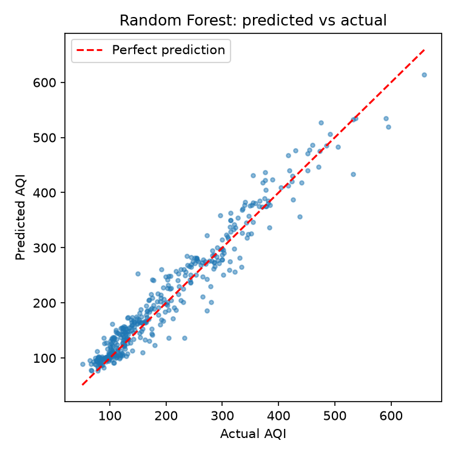
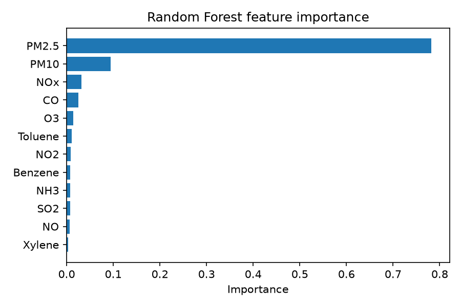

# AQI Prediction: Classical ML Baseline

A classical machine learning baseline for predicting the Air Quality Index (AQI) from pollutant measurements. It is the first part of my research on applying quantum computing to AQI monitoring: the models here set the accuracy that a hybrid quantum-classical model will later be compared against.

## What it does

- Loads an air quality CSV (pollutant levels such as PM2.5, PM10, NO2, SO2, CO, O3)
- Fills missing values and splits the data **by time** (older rows train, newer rows test) so the model is never tested on data from before its training period
- Trains and compares Linear Regression, Random Forest and Gradient Boosting
- Reports MAE, RMSE and R2, and saves a predicted-vs-actual plot and a feature importance chart

## Dataset

Download **Air Quality Data in India (2015 - 2020)** from Kaggle and place `city_day.csv` in the `data/` folder:
https://www.kaggle.com/datasets/rohanrao/air-quality-data-in-india

Any CSV with a date column, numeric pollutant columns and an AQI column also works (see the options below).

## How to run

```bash
pip install -r requirements.txt
python aqi_baseline.py --data data/city_day.csv --city Delhi
```

Options:

| Option | Default | Meaning |
|---|---|---|
| `--data` | required | Path to the CSV file |
| `--city` | all cities | Only use one city |
| `--target` | `AQI` | Name of the AQI column |
| `--date-col` | `Date` | Name of the date column |
| `--test-size` | `0.2` | Share of the newest rows used for testing |

## Results

Tested on Delhi data from the Kaggle dataset, using the newest 20% of rows as the test set.

| Model | MAE | RMSE | R2 |
|---|---|---|---|
| Linear Regression | 29.089 | 35.475 | 0.903 |
| Random Forest | 20.403 | 26.945 | 0.944 |
| Gradient Boosting | 21.486 | 28.015 | 0.939 |

Random Forest performed best. MAE and RMSE are in AQI units, and lower is better.






## Next steps

- [ ] Add weather variables (temperature, humidity, wind speed)
- [ ] Add lag features (yesterday's AQI) for next-day forecasting
- [ ] Build a hybrid quantum-classical model with Qiskit or PennyLane and compare it with these baselines
- [ ] Test on Dubai air quality data

## Tech

Python, pandas, scikit-learn, matplotlib

## What I learned
- Why a time-based split matters for forecasting: training on the oldest 80% and testing on the newest 20% avoids the model learning from the future.
- That AQI is calculated from the pollutant readings, so predicting it from them is partly relearning a formula; the next step is lag features and weather variables to forecast future days.
- How Random Forest, Gradient Boosting and Linear Regression compare on the same data, and how to read MAE, RMSE and R².
